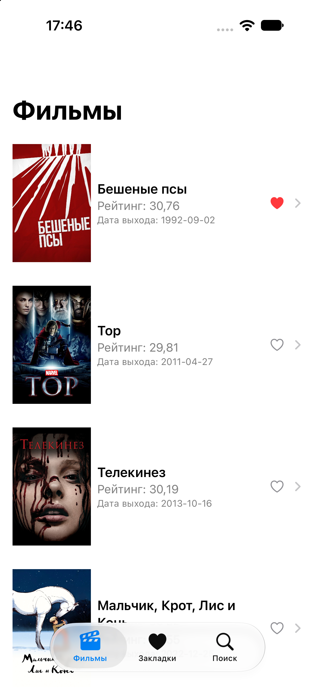
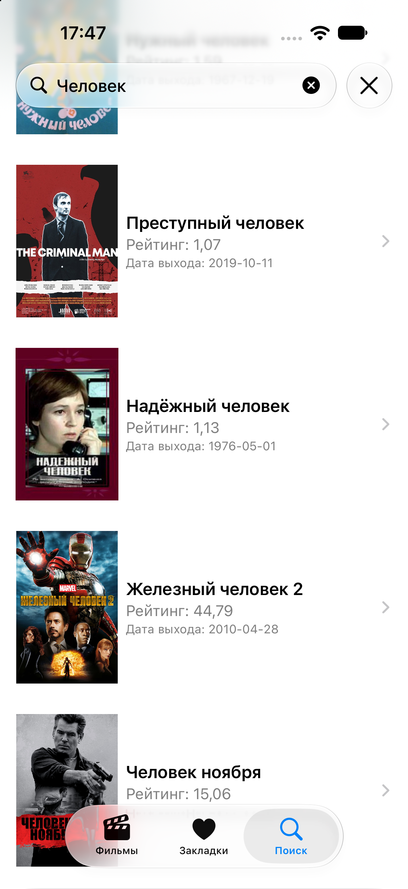
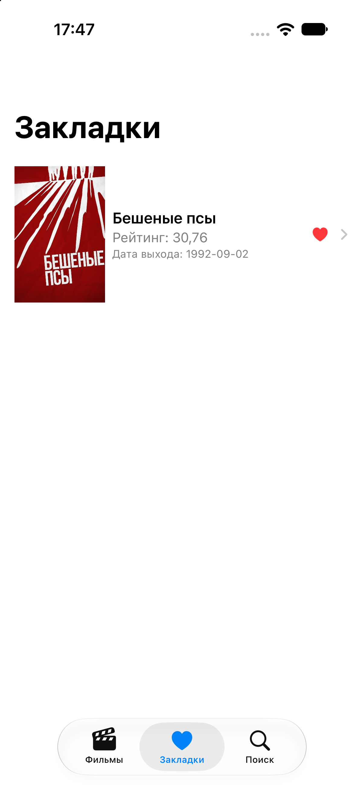

# Moovie
[](https://github.com/m1tzk/Moovie)

**Moovie** is a native iOS movie-discovery app built with SwiftUI and powered by [The Movie Database (TMDB)](https://www.themoviedb.org/). It loads movie information from a remote API and brings the main movie data, detailed information, credits, and artwork together for browsing.

## Screenshots

| Movie discovery | Search | Movie details |
|---|---|---|
|  |  |  |

<div align="center">
  <table>
    <tr>
      <th align="center">Cast and crew</th>
      <th align="center">Favourites</th>
    </tr>
    <tr>
      <td align="center">
        
      </td>
      <td align="center">
        
      </td>
    </tr>
  </table>
</div>

## Features

- **Movie discovery:** retrieves movie listings from TMDB.
- **Search:** looks up movies using a search query and represents loading, success, and error states in the UI.
- **Movie details:** fetches additional information for a selected movie.
- **Cast and crew:** loads credits and profile images for people associated with a movie.
- **Artwork loading:** builds poster, backdrop, and profile image URLs from TMDB image configuration and image paths.
- **Favourites:** supports saving favourite movie identifiers through a dedicated storage layer.
- **Mock service support:** separates API access from the UI logic so the app can use mock data during development.
- **Concurrent loading:** uses Swift concurrency to request independent movie data and images concurrently while retaining the original ordering of movie and credit lists.

## Tech stack

- **Swift** and **SwiftUI** — native iOS app and declarative UI.
- **MVVM-style separation** — views, observable view models, and service implementations are separated.
- **Observation (`@Observable`)** — view-model state updates.
- **`URLSession`** — HTTP requests to TMDB.
- **`async`/`await`, `async let`, and task groups** — asynchronous and concurrent network/image loading.
- **`Codable`** — decoding API responses into Swift models.
- **TMDB API** — movie data, details, credits, and image configuration.

## Architecture overview

```text
SwiftUI Views
    ↓ observe
Observable ViewModels
    ↓ call
Movie Service abstraction
    ├── Actual service → URLSession → TMDB API
    └── Mock service   → local/mock responses

Movie data + details + credits + images
    ↓
Screen-ready movie data for the UI
```

The service abstraction keeps networking concerns out of the views and allows real and mock data sources to be used without changing the screen code. Task groups are used for independent work; results are associated with their input indices so concurrent completion does not unexpectedly reorder the displayed content.

## Requirements

- macOS and a compatible version of Xcode.
- An iOS Simulator or a supported physical iPhone.
- A TMDB API key for requests to the live service.

The exact deployment target and minimum Xcode version are defined by the project settings in `Moovie.xcodeproj`.

## Configuration

Moovie reads the TMDB API key from the app's `Info.plist` configuration. The project configuration includes an optional local secrets file:

```text
Config.xcconfig
Secrets.xcconfig   # local-only; ignored by Git
```

1. Obtain an API key from [TMDB](https://www.themoviedb.org/settings/api).
2. Create `Secrets.xcconfig` alongside `Config.xcconfig` if it is not already present.
3. Define the build setting expected by `Config.xcconfig` for the TMDB API key, using the exact setting name referenced by the project configuration.
4. Verify that the build setting is propagated to the relevant `Info.plist` key (`TMDB_API_KEY`) before running the app.

Keep `Secrets.xcconfig` out of version control. Never paste a real API key into this README or commit it to the repository. If the local project configuration uses a different key name, follow the current Xcode build settings rather than adding a second, conflicting setting.

## Getting started

1. Clone the repository:

   ```bash
   git clone https://github.com/m1tzk/Moovie.git
   cd Moovie
   ```

2. Open `Moovie.xcodeproj` in Xcode.
3. Set up the local TMDB key as described above.
4. Select the `Moovie` scheme and an iOS Simulator or connected iPhone.
5. Build and run with **Product → Run** (`⌘R`).

## Repository structure

```text
Moovie/
├── Moovie.xcodeproj/   # Xcode project and build settings
├── Moovie/             # Application source code and resources
├── MoovieTests/        # Unit-test target
├── MoovieUITests/      # UI-test target
├── Config.xcconfig     # Shared build configuration
├── .gitignore          # Excludes local secrets, including Secrets.xcconfig
└── Secrets.xcconfig    # Local-only API key configuration; do not commit
```

## Author

**m1tzk** — [GitHub profile](https://github.com/m1tzk)

## Data and attribution

Movie metadata and images are provided by [The Movie Database (TMDB)](https://www.themoviedb.org/). This project uses TMDB data; it is not endorsed or certified by TMDB.
